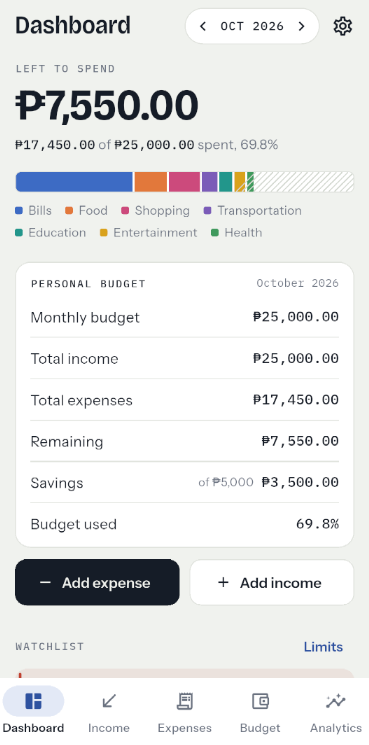
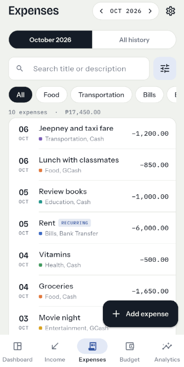
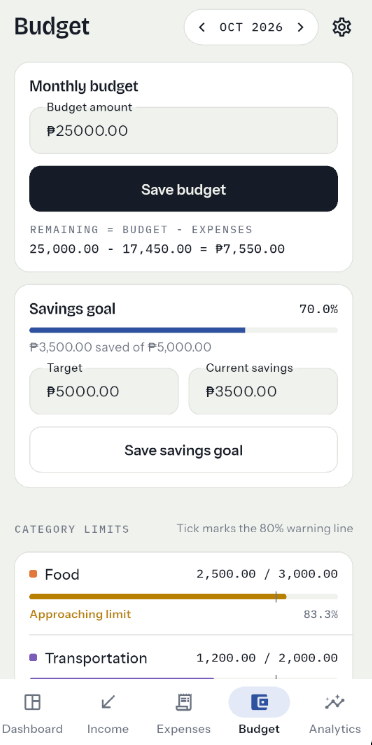
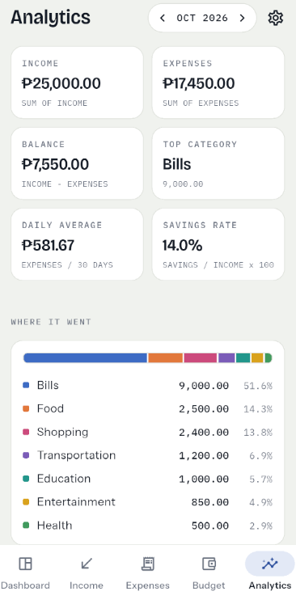

# Personal Budget Tracker

MP101 Mobile Programming 101, Intermediate Laboratory Activity
Flutter + Dart, with Cloud Firestore (offline persistence enabled)

**Student:** Jhanry Espeso and Paul Bautista

A mobile app for managing income, expenses, monthly budgets, category limits,
savings goals, recurring bills, and financial analytics. All totals are
calculated from the saved records, nothing is hard-coded.

## Screenshots

| Dashboard | Expenses | Budget | Analytics |
| --- | --- | --- | --- |
|  |  |  |  |

## Features

| Section | Feature | Where |
| --- | --- | --- |
| 1 | Dashboard summary for the selected month | `screens/dashboard_screen.dart` |
| 2 | Income add, edit, delete, history | `screens/income_screen.dart`, `widgets/income_form.dart` |
| 3, 4 | Expense CRUD with the 8 required categories | `screens/expense_screen.dart`, `widgets/expense_form.dart` |
| 5 | Monthly budget, Remaining = Budget - Expenses | `screens/budget_screen.dart` |
| 6 | Category limits with normal / warning (80%) / exceeded (100%) states | `widgets/budget_progress.dart` |
| 7 | Savings goal and progress | `screens/budget_screen.dart` |
| 8 | Analytics: income, expenses, balance, top category, daily average, savings rate | `screens/analytics_screen.dart` |
| 9 | Search and filters: category, date range, payment method, amount range | `models/expense_filter.dart` |
| 10 | Cash, GCash, Debit Card, Credit Card, Bank Transfer, Other | `utils/constants.dart` |
| 11 | Recurring expenses with Mark paid and next payment date | `widgets/recurring_tile.dart` |
| 12, 13 | Cloud Firestore with offline persistence | `services/database_service.dart` |
| 17, 18 | Validation, empty states, limit alerts | `utils/validators.dart`, `widgets/budget_alerts.dart` |
| 19 | Monthly comparison with signed difference | `screens/analytics_screen.dart` |

## Database and offline use

Data is saved in Cloud Firestore. Offline persistence keeps a full copy on the
phone, so the app works with no internet and data stays after closing and
reopening. Changes made offline upload automatically when the phone is back online.

Collections: `incomes`, `expenses`, `recurring`, `budgets` (per month),
`savings` (per month), `categoryLimits` (per category), `settings`.

## Required calculations (`lib/services/database_service.dart`)

| Formula | Code |
| --- | --- |
| Remaining Budget = Monthly Budget - Total Expenses | `remainingBudget()` |
| Budget Used = Total Expenses / Monthly Budget x 100 | `budgetUsedPercent()` |
| Percentage Used = Category Expenses / Category Budget x 100 | `CategoryBudget.percentUsed` |
| Savings Progress = Current Savings / Savings Target x 100 | `SavingsGoal.progress` |
| Savings Rate = Savings / Total Income x 100 | `savingsRate()` |
| Average Daily Spending = Total Expenses / Days | `averageDailySpending()` |
| Monthly difference = This month - Last month | `expenseDifference()` |

Unit tests for these are in `test/calculations_test.dart`.

## Project structure

```
lib/
├── models/      income, expense, budget (Budget + CategoryBudget), savings_goal,
│                recurring_expense, expense_filter
├── screens/     dashboard, income, expense, budget, analytics, settings
├── services/    database_service.dart (Firestore + all calculations)
├── widgets/     summary_card, expense_tile, budget_progress, budget_strip, forms
├── utils/       constants, formatters, validators, app_theme, firestore_codec
└── main.dart    Firebase startup, theme, bottom navigation
```

Navigation: bottom NavigationBar with Dashboard, Income, Expenses, Budget,
Analytics. Settings opens from the gear icon.

## How to run

Requires Flutter 3.35 or newer.

```
flutter pub get
flutter run
```

The app is already linked to its Firebase project through
`lib/firebase_options.dart` and `android/app/google-services.json`.
On the first launch it loads sample data for September and October 2026.
Settings > Reload sample data restores it at any time.

Run the tests with:

```
flutter test
```